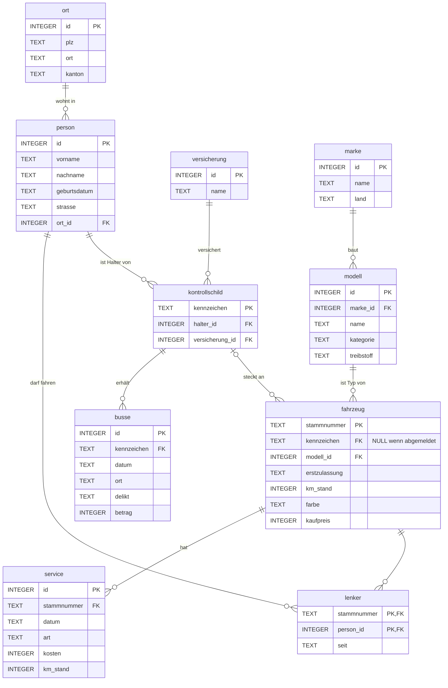

# ERD Beispieldatenbank «Fahrzeuge und Halter»

Diese Datenbank lädt der SQL Tab von sandbox.lernknoten.ch als Standard. Die Daten sind erfunden.

## Warum diese Schlüssel

* **Ort** hat eine eigene `id` als Primärschlüssel. Die PLZ eignet sich nicht: In der Schweiz können sich mehrere Ortschaften eine PLZ teilen, und eine PLZ kann über eine Kantonsgrenze reichen. Eindeutig ist erst die Kombination aus PLZ und Ortsname (`UNIQUE (plz, ort)`). Die PLZ ist `TEXT`, weil sie eine Kennung ist und keine Zahl zum Rechnen.
* **Kennzeichen** ist der Primärschlüssel von `kontrollschild`. In der Schweiz gehört das Schild dem Halter, nicht dem Fahrzeug. Es wechselt beim Autokauf mit und kann als Wechselschild für zwei Fahrzeuge gelten (`BE 123456`).
* **Stammnummer** ist der Primärschlüssel von `fahrzeug`. Sie bleibt ein Fahrzeugleben lang gleich, auch wenn das Schild wechselt.
* `fahrzeug.kennzeichen` darf NULL sein: Das Fahrzeug `390.826.517` ist abgemeldet.
* Bussen hängen am Kennzeichen, weil ein Radar nur das Schild sieht. Bei einem Wechselschild ist deshalb nicht klar, welches Fahrzeug gefahren ist.
* `lenker` ist eine n:m Beziehung: Wer ausser dem Halter darf ein Fahrzeug fahren.

## Fälle zum Üben

* Wechselschild: `BE 123456` steckt an zwei Fahrzeugen.
* Schild ohne Fahrzeug: `ZH 4711` (Noah Weber hat sein Schild hinterlegt).
* Person ohne Schild: Mia Schmid ist nur Lenkerin.
* Fahrzeuge ohne Service und Halter ohne Bussen für LEFT JOIN Übungen.
